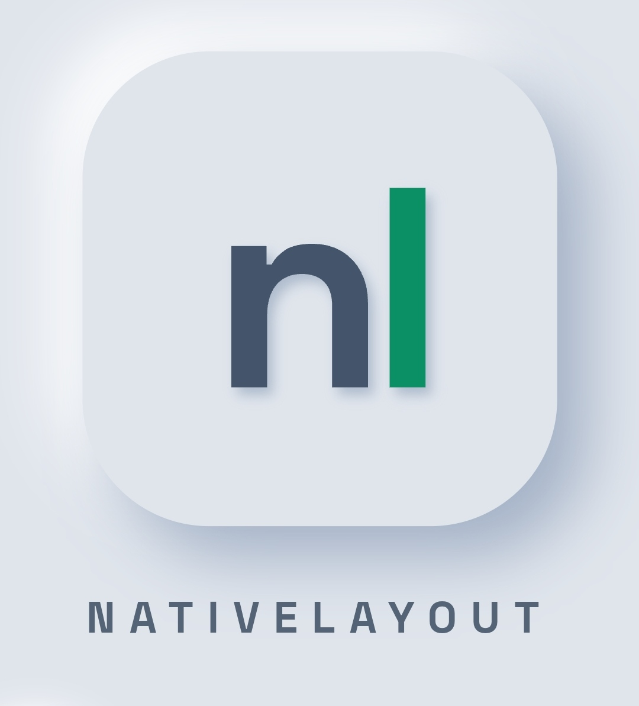

<div align="center">



<h1>nativelayout</h1>

<p><strong>Create native interfaces from HTML, in any language.</strong></p>

<a href="https://jitpack.io/#getnativelayout/nativelayout"></a>
<a href="LICENSE"></a>
<br>
<a href="https://discord.gg/638USuPnpk"></a>

</div>

<br>

<p align="justify">
A screen is written once, in a plain text file that looks like HTML. The same file works in any language: each language only supplies the Expander, the Engine and the native host. No WebView, no canvas: the file becomes real native views.
</p>

<p align="justify">
The file describes the screen. The logic (state, taps) stays in your language, in a plain loop.
</p>

## Community

<p align="justify">
<a href="https://discord.gg/638USuPnpk">Join our Community on Discord</a> to ask questions, share ideas and show the screens you built. Bugs and feature proposals go in the <a href="../../issues">issue tracker</a>, so they are not lost.
</p>

## Why nativelayout

- **HTML you already know**, plus three additions: `{value}`, `if` / `for` lines, and a `<style>` with simple selectors.
- **Native output.** Buttons, fields, lists and images are real platform views.
- **No functions, classes or variables in the file.** State and taps live in your code.
- **Conditions and repetition**, so it is more than a static canvas.
- **Efficient updates.** Each `render` is diffed against the previous screen and only the changes are applied. Text typed in a field is kept.
- **Clear errors** with the line of the `.nl` file.

## Implementations

<p align="justify">
The <code>.nl</code> file is the same everywhere. Each language only needs an Expander, an Engine and a native host. Every implementation lives in its own folder, is published as a library, and has its own guide and examples. The Android folder also contains an editor app (<code>android/app</code>) with live preview, used to test screens on-device.
</p>

| Language | Target | Status | Folder |
|---|---|---|---|
| Kotlin | Android (native views) | implemented | [`android/`](android/) |
| Java | Android (native views) | planned | - |
| Python | Kivy | planned | - |
| Python | Tkinter | planned | - |
| Swift | iOS (UIKit) | planned | - |
| JavaScript / TypeScript | React Native | planned | - |
| Dart | Flutter | planned | - |
| C# | .NET MAUI | planned | - |
| Java | Swing / JavaFX (desktop) | planned | - |
| C++ | Qt | planned | - |
| Rust | desktop | planned | - |
| Go | desktop | planned | - |

<p align="justify">
Want to add a language? See <a href="#contributing">Contributing</a>.
</p>

## Install (Android)

<p align="justify">
Published through <a href="https://jitpack.io/#getnativelayout/nativelayout">JitPack</a>. First add the JitPack repository (<code>https://jitpack.io</code>) to your project:
</p>

```kotlin
// settings.gradle.kts
dependencyResolutionManagement {
    repositories {
        google()
        mavenCentral()
        maven("https://jitpack.io")
    }
}
```

Then add the dependency:

```kotlin
// app/build.gradle.kts
dependencies {
    implementation("com.github.getnativelayout.nativelayout:nativelayout-android:v0.1.6")
    implementation("com.github.getnativelayout.nativelayout:nativelayout-core:v0.1.6")
}
```

<p align="justify">
<code>nativelayout-android</code> and <code>nativelayout-core</code> are both needed, with the same version. To use only the parser and Expander (pure JVM), depend on <code>nativelayout-core</code> alone. Minimum SDK: 21.
</p>

<p align="justify">
Quick start and examples: <a href="android/README.md"><code>android/README.md</code></a> and <a href="android/examples/"><code>android/examples/</code></a>.
</p>

## API

<p align="justify">
An app is a set of screen functions. Each one holds its state, reads the taps and returns <code>view(...)</code> or <code>go { ... }</code>; the entry point only starts the first one (see <a href="SPEC.md"><code>SPEC.md</code></a>, section 8). The same verbs exist in every language. Data passed to <code>view</code> is plain: text, number, bool, list and map.
</p>

| Verb | Does |
|---|---|
| `screen(name)` | base layer: loads a `.nl` file and returns a screen |
| `state(initial)` | the state of the screen: the same object on every call, a new one after `go` |
| `view(name, data)` | returns the screen to show, with its data |
| `go(function)` | jumps to another screen function |
| `render(screen, data)` | base layer: shows the screen with the data, waits for a tap, returns `true`; `false` when the window closes |
| `click(target)` | `true` if the `id` (or `".class"`) was tapped |
| `clickIndex()` | position, from 0, of the tapped element of the class |
| `value(id)` | text of a field, `""` if the id does not exist |
| `checked(id)` | state of a checkbox, `false` if it does not exist |
| `setValue(id, text)` | fills or clears a field (`"1"` / `"0"` for a checkbox) |
| `save(key, text)` | stores text on the device |
| `load(key)` | reads stored text |
| `exists(key)` | `true` if the key is stored |
| `delete(key)` | removes a stored key |
| `close()` | releases the host |

## The file format

<p align="justify">
A screen is one <code>.nl</code> file: zero or more linked stylesheets, an optional <code>&lt;style&gt;</code>, and exactly one <code>&lt;body&gt;</code>, all wrapped in <code>&lt;nativelayout&gt;</code>.
</p>

```
<nativelayout>
    <link rel="stylesheet" href="theme.css">   (zero or more)
    <style> ... </style>                       (optional)
    <body> ... </body>                         (exactly one)
</nativelayout>
```

### Tags

| Tag | Native component |
|---|---|
| `div` | container |
| `span`, `p`, `h1`, `h2`, `h3` | text |
| `button` | button |
| `input` (`text`, `password`, `number`, `checkbox`) | field or checkbox |
| `textarea` | multi-line field |
| `img` | image (`data:` URI or a name resolved by the host) |
| `ul`, `li` | list with bullets |

### Style

- Selectors: `:root`, `body`, tag, `.class`, `#id`, and comma lists. Variables with `var(--name)`.
- Properties: `color`, `background`, `font-size`, `font-weight`, `padding`, `margin`, `border-radius`, `border`, `display`, `flex-direction`, `flex`, `justify-content`, `align-items`, `gap`, `width`, `height`.
- Units: `rem`, `px` (dp) and `0`. Percentages only in `width` and `height`.
- Not supported in v1: descendant and child selectors, pseudo-classes, attribute selectors, `@media`, `<script>`.

<p align="justify">
Values (<code>{name}</code>), control lines (<code>if</code>, <code>elif</code>, <code>else</code>, <code>for</code>, <code>end</code>), the cascade rules, error messages and complete examples are in <a href="SPEC.md"><code>SPEC.md</code></a>.
</p>

## How it works

```
panel.nl + data  ->  Expander  ->  HTML with inline styles  ->  Engine  ->  native views
                     (if, for,                                  (parse,      (host)
                      {value}, selectors)                        diff, style)
```

- **Expander:** evaluates control lines and `{values}` with your data and applies the selectors.
- **Engine:** HTML parser, style reader, neutral tree and diff.
- **Host:** creates and updates the native components.

## Repository layout

```
android/     Kotlin implementation (core, android, app), with its own README and examples
SPEC.md      the file format, shared by every language
```

## Contributing

<p align="justify">
Issues and pull requests are welcome. A new language implementation needs an Expander, an Engine and a native host that follow <code>SPEC.md</code>; the <code>.nl</code> files must work unchanged. Put it in its own folder, with its own README and examples.
</p>

## License

[MIT](LICENSE)